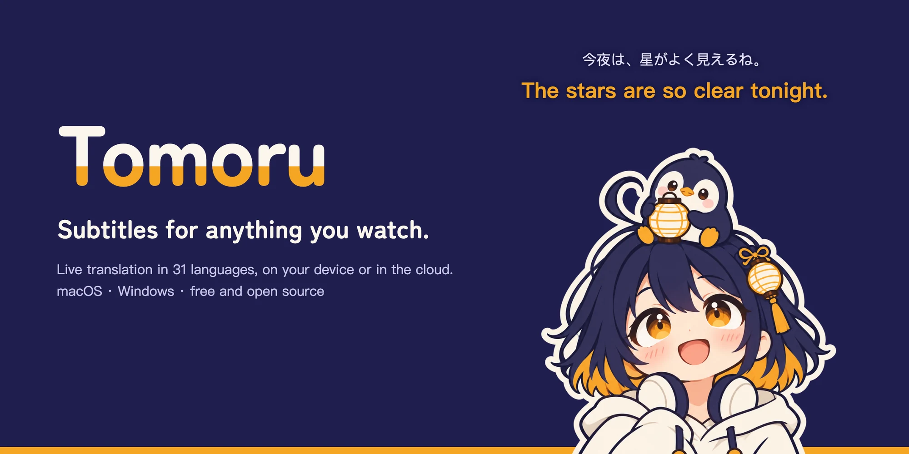

<p align="center">
  
</p>

<p align="center">
  <a href="https://github.com/ACAne0320/Tomoru/releases/latest"></a>
  
  <a href="LICENSE"></a>
</p>

<p align="center">
  <a href="app/go.mod"></a>
  <a href="https://github.com/egoist/mygo"></a>
  <a href="https://github.com/bilibili/Index-Translate"></a>
  <a href="https://github.com/QwenAudio/SenseVoice"></a>
</p>

<p align="center">
  <a href="https://awesomemygo.dev/apps/tomoru"></a>
</p>

<p align="center"><a href="#download">Download</a> · <a href="README_zh.md">中文</a> · <a href="app/CHANGELOG.md">Changelog</a><br>
</p>
<p align="center">Built with <a href="https://github.com/egoist/mygo">MyGo</a> · translation by <a href="https://github.com/bilibili/Index-Translate">Index-Translate</a> · speech recognition by <a href="https://github.com/QwenAudio/SenseVoice">SenseVoice</a>, <a href="https://github.com/QwenLM/Qwen3-ASR">Qwen-ASR</a> and <a href="https://developer.apple.com/documentation/speech/speechanalyzer">Apple</a></p>

Watching foreign streams, raw anime or VTuber clips, playing games, or sitting in a meeting? Tomoru
listens to what your computer plays, recognizes the speech and shows live bilingual subtitles on
your screen.


> The video is [MyGO!!!!!メンバーの日常「十五夜」](https://www.youtube.com/watch?v=aX1HB-XOxQk); the live
> bilingual subtitles are Tomoru's.

- **Subtitles for anything**: videos, streams, games, meetings. Listen to all of your computer's
  sound, or just one app's (say, a stream in the browser while you play a game). Drag, resize and
  lock the subtitles so clicks pass through, and hide them from screen recordings.
- **On your computer or in the cloud, your call**: speech recognition and translation can both run
  fully offline on your computer, or use cloud services. Pick local, and your audio and text never
  leave your computer; pick the cloud, and data goes only to the service you chose.
- **Translate ahead**: no waiting for the speaker to finish. You see the gist of the first half
  right away, then the full translation once the sentence ends, so you're never stuck waiting on a
  stream.
- **Scenes and glossaries**: speech recognition often mishears names and moves as similar words
  (*ニンフィア / Sylveon* heard as *インフィア*, *メテオ / Meteor* as *メデオ*), and translators often
  take names literally (*クラウド / Cloud* translated as "cloud"). Make a scene for the anime,
  streamers or games you watch: names stay consistent, misheard originals get fixed too, and with
  your own chat API, Tomoru can learn new names from your subtitle history.
- **Translate text on screen too**: unvoiced game dialogue, signs in a video, stream chat. Press
  `⌥⇧S` (`Alt+Shift+S` on Windows) and select part of the screen, or take a screenshot first and
  press the shortcut, and the translation shows up.
- In English, Simplified and Traditional Chinese, Japanese and Korean, light and dark.

## Download

Get the latest version from [Releases](https://github.com/ACAne0320/Tomoru/releases). The app
updates itself after that.

| Platform | Needs |
|---|---|
| macOS | macOS 26 or later, Apple silicon |
| Windows | Windows 11, x64 |

Tomoru isn't notarized by Apple or signed for Windows yet, so the first launch needs one extra step:
- **macOS**: open Tomoru. When macOS says it can't verify it, open System Settings › Privacy &
  Security, and click "Open Anyway" next to Tomoru. After that, Tomoru asks only for System Audio
  Recording, to hear what plays.
- **Windows**: when SmartScreen warns, click "More info", then "Run anyway".

Or install from a terminal: the script downloads the latest version, checks it, and
installs it. On a Mac it goes in /Applications. Either way it opens without the "Open Anyway" or
SmartScreen step.

```sh
# macOS
curl -fsSL https://github.com/ACAne0320/Tomoru/releases/latest/download/install.sh | sh
```

```powershell
# Windows (PowerShell)
irm https://github.com/ACAne0320/Tomoru/releases/latest/download/install.ps1 | iex
```

## Privacy

- Tomoru listens to what your computer plays, not your microphone.
- Where your audio and text go depends on the engines you pick: local recognition and local
  translation stay on your computer. Cloud recognition sends audio to that cloud service.
- The subtitle history is off by default. Turn it on to keep what was heard and translated; the
  originals and translations stay on your computer, and you can delete them any time.
- Translating text on screen translates only the part you select, and keeps neither the picture
  nor its translation. The picture goes to the engine you pick for pictures: Index-Translate in
  the cloud unless you choose a local model or your own API.

## Making bilingual videos

Tomoru is for watching. If you make videos with bilingual subtitles and care about getting them
right, try [OpenBBQ](https://github.com/ACAne0320/OpenBBQ), another project of mine: give an AI
agent a video link or file, and you get bilingual subtitles you can edit (ASS) and the video with
them burned in. Names it learns from one creator's videos carry over to their next ones, and you
can polish every line in its review view or in Aegisub before you publish.

## Build

### macOS

Needs macOS 26 on Apple silicon, Go 1.27.3 or later and Xcode 26 or its Command Line Tools
(`xcode-select --install`).

```sh
scripts/setup.sh              # the engine, local recognition, voice detector and llama-server
cd app
go tool mygo dev              # run it; it rebuilds and restarts as you edit
go test ./...                 # test it
go tool mygo build -sign -    # package it into app/build/darwin-arm64/
```

### Windows

Needs Windows 11 x64, Go 1.27.3 or later and [MSYS2](https://www.msys2.org) with its MinGW-w64
compiler (`pacman -S mingw-w64-x86_64-gcc unzip`). Run these in MSYS2's MINGW64 shell:

```sh
export PATH="$PATH:/c/Program Files/Go/bin"   # MSYS2 doesn't see Go by itself
scripts/setup.sh                              # the engine, local recognition, voice detector and llama-server
cd app
go tool mygo dev                              # run it; it rebuilds and restarts as you edit
go test ./...                                 # test it
go tool mygo build                            # package it into app/build/windows-amd64/
```

The [development guide](docs/development.md) has the checks and tests, and the
[architecture](docs/architecture.md) says where the code lives.

Want to contribute? See [CONTRIBUTING](CONTRIBUTING.md). Report security issues as
[SECURITY](SECURITY.md) says.

## Credits

| For | Project | By |
|---|---|---|
| Translation (the free cloud API, 2B / 9B / 35B; the on-device 2B / 9B models) | [Index-Translate](https://github.com/bilibili/Index-Translate) | [bilibili's Index team](https://huggingface.co/IndexTeam) |
| Speech recognition | [SenseVoice](https://github.com/QwenAudio/SenseVoice) | [Alibaba's Qwen Audio team](https://github.com/QwenAudio) |
| Speech recognition | [Qwen3-ASR](https://github.com/QwenLM/Qwen3-ASR) | [Alibaba's Qwen team](https://github.com/QwenLM) |
| Speech recognition on macOS | [Apple speech recognition](https://developer.apple.com/documentation/speech/speechanalyzer) | [Apple](https://www.apple.com) |
| UI framework | [MyGo](https://github.com/egoist/mygo) | [EGOIST](https://github.com/egoist) |
| Running on-device recognition | [sherpa-onnx](https://github.com/k2-fsa/sherpa-onnx) | [k2-fsa](https://github.com/k2-fsa) |
| Running on-device translation and Qwen3-ASR | [llama.cpp](https://github.com/ggml-org/llama.cpp) | [ggml-org](https://github.com/ggml-org) |
| Voice activity detection | [Silero VAD](https://github.com/snakers4/silero-vad), converted to Core ML by [FluidInference](https://huggingface.co/FluidInference/silero-vad-coreml) | [Silero](https://silero.ai) |
| Icons | [Lucide](https://lucide.dev) | [Lucide contributors](https://github.com/lucide-icons) |

The free cloud translation model is Index-Translate's. If you like it, give it a star on
[GitHub](https://github.com/bilibili/Index-Translate)!

The [third-party license inventory](docs/third-party-licenses.md) has each project's version,
license and notices.

Special thanks to [LINUX DO](https://linux.do) and [Appinn](https://www.appinn.com) for supporting open-source software, and to [Awesome MyGo](https://awesomemygo.dev/apps/tomoru) for listing Tomoru in its showcase.

## Tomoru and Rubi

<p align="center"></p>

The app is named after its mascot, Tomoru (ともる), a girl who carries a paper lantern: 灯る means
"to light up". The penguin on her head is Rubi (ルビ), named after the small readings printed over
hard words (furigana). They doze in the menu bar while nothing is translated, and wake up when it
starts.

> I-it's not a nod to MyGO!!!!!'s [Tomorin](https://en.wikipedia.org/wiki/Tomori_Takamatsu) or
> anything!

## License

The code is licensed under the GNU General Public License v3.0 or later ([LICENSE](LICENSE)). The
name, icons and mascot are not: see [TRADEMARKS](TRADEMARKS.md).
