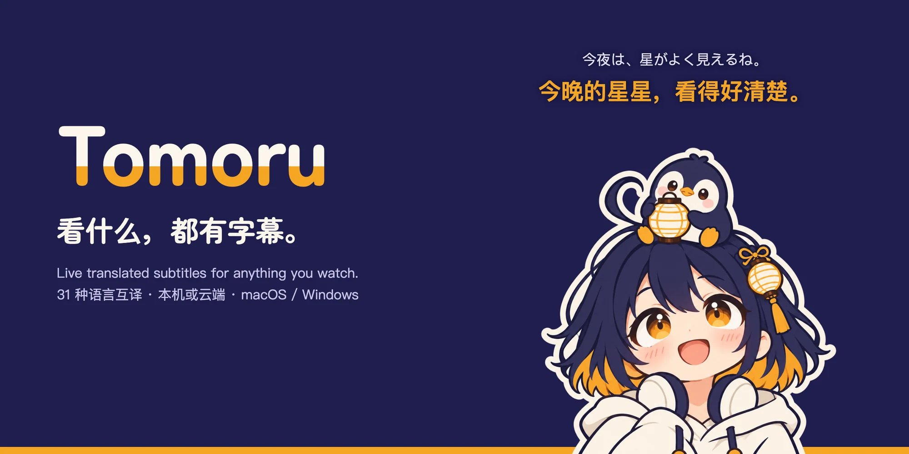

<p align="center">
  
</p>

<p align="center">
  <a href="https://github.com/ACAne0320/Tomoru/releases/latest"></a>
  
  <a href="app/go.mod"></a>
  <a href="https://github.com/egoist/mygo"></a>
  <a href="https://github.com/bilibili/Index-Translate"></a>
  <a href="https://github.com/QwenAudio/SenseVoice"></a>
  <a href="LICENSE"></a>
</p>

<p align="center"><a href="#下载">下载</a> · <a href="README.md">English</a> · <a href="app/CHANGELOG.md">更新记录</a><br>
</p>
<p>
    <sub>基于 <a href="https://github.com/egoist/mygo">MyGo</a> 构建 · 翻译由 <a href="https://github.com/bilibili/Index-Translate">Index-Translate</a> 提供 · 语音识别由 <a href="https://github.com/QwenAudio/SenseVoice">SenseVoice</a>、<a href="https://github.com/QwenLM/Qwen3-ASR">Qwen-ASR</a> 和 <a href="https://developer.apple.com/documentation/speech/speechanalyzer">Apple</a> 提供</sub></p>

看外语直播、生肉番剧、VTuber 切片、打游戏或开会时，Tomoru 会直接听电脑播放的声音，识别语音并把双语字幕实时显示在屏幕上。


> 视频源来自 [MyGO!!!!!メンバーの日常「十五夜」](https://www.youtube.com/watch?v=aX1HB-XOxQk)，实时双语字幕来自 Tomoru 。

- **看什么都能配字幕**：视频、直播、游戏、会议都能用。可以听系统的全部声音，也可以指定只听某一个应用（比如边打游戏边只听浏览器里的直播）。字幕可以自由拖动、缩放、锁定点击穿透，也能在录屏时自动隐藏。
- **本机或云端，自己决定**：语音识别和翻译都可以完全在本机离线运行，也可以使用云端服务。选择本地时，声音和文字不会离开你的电脑；选择云端时，数据只会发送给你所选的云端服务。
- **抢先翻译**：不等对方把整句话说完，先实时显示前半句的大意，说完后再更新为完整译文，看直播不用干等。
- **翻译场景和专名对照表**：语音识别容易把角色或招式听成近音词（比如把「ニンフィア（仙子伊布）」听成「インフィア」、把「メテオ（陨石）」听成「メデオ」），翻译模型也常把名字按字面硬翻（比如把「クラウド（克劳德）」译成「云」）。你可以按常看的番剧、主播或游戏建「场景」词表，不仅保证译名统一，连识别听错的原文字幕也会一起改对；接上你自己的对话 API，还能从字幕记录里学到新名字。
- **顺手翻译屏幕上的文字**：遇到没配音的游戏对话框、视频里的招牌或直播间弹幕，按 `⌥⇧S`（Windows 为 `Alt+Shift+S`）直接框选屏幕，或先截图再按快捷键，就能看到译文。
- 界面支持简体中文、繁体中文、英文、日文和韩文；支持浅色和深色外观。

## 下载

从 [Releases](https://github.com/ACAne0320/Tomoru/releases) 下载最新版本。之后 app 会自动更新。

| 平台 | 要求 |
|---|---|
| macOS | macOS 26 或更新，Apple 芯片 |
| Windows | Windows 11，x64 |

Tomoru 目前没有经过 Apple 公证，Windows 版也没有签名，所以第一次打开要多一步：
- **macOS**：打开 Tomoru。macOS 提示无法验证它时，打开 系统设置 › 隐私与安全性，点 Tomoru 旁边的「仍要打开」。之后 Tomoru 只申请「仅系统录音」权限，用来听播放的声音。
- **Windows**：SmartScreen 警告时，点「更多信息」，再点「仍要运行」。

## 隐私

- Tomoru 听的是电脑播放的声音，不使用麦克风。
- 声音和文字发到哪里，取决于你选的引擎：本地识别和本地翻译都留在你的电脑上。云端识别发送到对应的云端服务。
- 字幕记录默认关闭。打开后，可以保留听/翻译过的内容，原文和译文只存在你的电脑上，可以随时删除。
- 翻译屏幕上的文字时，只翻译你框选的那一块，图片和译文都不保存。

## 制作双语视频

Tomoru 是用来边看边翻译的。如果你要制作双语字幕视频，对字幕质量有要求，可以试试我的另一个项目 [OpenBBQ](https://github.com/ACAne0320/OpenBBQ)：把视频链接或本地文件交给 AI Agent，就能得到可编辑的双语字幕（ASS）和烧录好字幕的成片。它从一位创作者的视频里学到的名字，会沿用到这位创作者之后的视频。发布前你还可以在它的校对界面或 Aegisub 里逐句精修。

## 构建

### macOS

需要 Apple 芯片的 macOS 26、Go 1.27.3 或更新版本，以及 Xcode 26 或它的命令行工具（`xcode-select --install`）。

```sh
scripts/setup.sh              # 引擎、本机识别、人声检测和 llama-server
cd app
go tool mygo dev              # 运行；改代码后自动重新构建并重启
go test ./...                 # 测试
go tool mygo build -sign -    # 打包到 app/build/darwin-arm64/
```

### Windows

需要 Windows 11 x64、Go 1.27.3 或更新版本，以及 [MSYS2](https://www.msys2.org) 和它的 MinGW-w64 编译器（`pacman -S mingw-w64-x86_64-gcc unzip`）。在 MSYS2 的 MINGW64 终端里运行：

```sh
export PATH="$PATH:/c/Program Files/Go/bin"   # MSYS2 默认找不到 Go
scripts/setup.sh                              # 引擎、本机识别、人声检测和 llama-server
cd app
go tool mygo dev                              # 运行；改代码后自动重新构建并重启
go test ./...                                 # 测试
go tool mygo build                            # 打包到 app/build/windows-amd64/
```

检查和测试见 [开发指南](docs/development_zh.md)，代码在哪里见 [架构](docs/architecture_zh.md)。

想要参与贡献？见 [贡献指南](CONTRIBUTING_zh.md)。安全问题请按 [安全策略](SECURITY_zh.md) 报告。

## 致谢

| 用途 | 项目 | 来自 |
|---|---|---|
| 翻译（免费云端 35B 接口、本机 2B / 9B 模型） | [Index-Translate](https://github.com/bilibili/Index-Translate) | [哔哩哔哩 Index 团队](https://huggingface.co/IndexTeam) |
| 语音识别 | [SenseVoice](https://github.com/QwenAudio/SenseVoice) | [阿里千问语音团队](https://github.com/QwenAudio) |
| 语音识别 | [Qwen3-ASR](https://github.com/QwenLM/Qwen3-ASR) | [阿里千问团队](https://github.com/QwenLM) |
| 语音识别（macOS） | [Apple 语音识别](https://developer.apple.com/documentation/speech/speechanalyzer) | [Apple](https://www.apple.com.cn) |
| 界面框架 | [MyGo](https://github.com/egoist/mygo) | [EGOIST](https://github.com/egoist) |
| 运行本机识别模型 | [sherpa-onnx](https://github.com/k2-fsa/sherpa-onnx) | [k2-fsa](https://github.com/k2-fsa) |
| 运行本机翻译模型和 Qwen3-ASR | [llama.cpp](https://github.com/ggml-org/llama.cpp) | [ggml-org](https://github.com/ggml-org) |
| 人声检测 | [Silero VAD](https://github.com/snakers4/silero-vad)，Core ML 版本由 [FluidInference](https://huggingface.co/FluidInference/silero-vad-coreml) 转换 | [Silero](https://silero.ai) |
| 图标 | [Lucide](https://lucide.dev) | [Lucide 社区](https://github.com/lucide-icons) |

默认的免费云端翻译模型由 Index-Translate 提供，喜欢的话去 [GitHub](https://github.com/bilibili/Index-Translate) 给它点个 Star 吧！

各项目的版本、许可证和声明见[第三方许可证清单](docs/third-party-licenses_zh.md)。

## Tomoru 和 ルビ

<p align="center"></p>

app 的名字来自看板娘 Tomoru（ともる），一个提着纸灯笼的女孩：灯る 是「点亮」的意思。她头顶的企鹅叫 ルビ（Rubi），名字取自标在难字上方、帮人读懂的那行小字（振假名）。没在翻译时，她们在菜单栏里打瞌睡；开始翻译，就一起醒过来。

> 才、才没有 neta Mygo 中的 [Tomorin](https://zh.wikipedia.org/wiki/%E9%AB%98%E6%9D%BE%E7%87%88) 呢！

## 许可证

代码以 GNU 通用公共许可证 v3.0 或更新版本授权（[LICENSE](LICENSE)）。名称、图标和吉祥物不在此列：见 [商标说明](TRADEMARKS_zh.md)。
