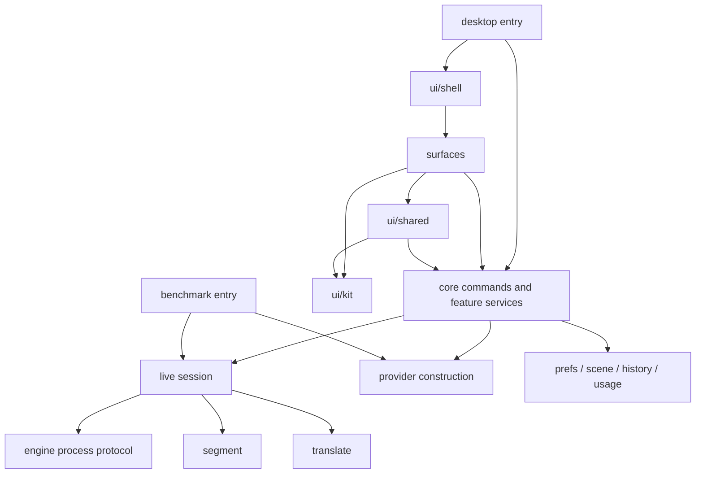

# Architecture

[中文](architecture_zh.md)

This document describes the code boundaries as they are maintained. For setting up and checking
your work, see the [development guide](development.md); for the decisions behind the boundaries,
see [ADR 001](adr/001-state-events-and-runtime-boundaries.md).

## Directories

| Directory | What it owns |
| --- | --- |
| `app/` | Go module `tomoru`: the app's state, the live pipeline, storage and the desktop UI |
| `app/main.go` | The desktop entry point: finds the app's resources, makes the root context, injects what the platform provides |
| `app/internal/core/` | The app's commands, the owners of each feature's state, and the coordinator |
| `app/internal/live/` | One live session: recognition events, segmenting, the translation queue and each sentence's lifecycle |
| `app/internal/asr/` | Recognition: the interface a session runs, the recognizers to choose (`Specs`) and their adapters: `asr/batch` runs decoders of stretches of speech (`asr/sensevoice`, `asr/llama`, `asr/openai`), `asr/qwencloud` and `asr/openai`'s `Realtime` stream to the cloud, `asr/apple` tells Apple's recognition in the engine when to finalize; see [recognition](recognition.md) |
| `app/internal/provider/` | Making translators, shared by the desktop app and the benchmark |
| `app/internal/engine/`, `resource/` | The child-process protocol, and finding resources in explicit roots; no desktop framework |
| `app/internal/segment/`, `translate/` | The segmenting rules; the translator interface and its implementations |
| `app/internal/lang/` | The languages, by BCP 47 code: which there are, their names (CLDR, from `golang.org/x/text`) and how each is written; what each engine recognizes is the engine's to say |
| `app/internal/prefs/`, `scene/`, `history/`, `usage/` | User data, each with its file format; `atomicfile/` replaces files atomically |
| `app/internal/proxy/` | How the cloud is reached, as Preferences says: through the system's proxy (MyGo's `netproxy`, with PAC files), one of the user's, or directly; Go's default transport asks it, so the cloud's recognition and translation, the user's APIs and model downloads all go its way, and loopback (the local models' servers) never through a proxy |
| `app/internal/ui/kit/` | Generic controls, design tokens, theme, shortcut input; knows nothing of the app's state or domain types |
| `app/internal/ui/shared/` | Showing errors and names, the audio source menu, binding shortcuts to the app, and the navigation interface |
| `app/internal/ui/shell/` | Windows, navigation, global shortcuts and main-thread scheduling |
| `app/internal/ui/{guide,settings,panel,overlay,imagecard}/` | The surfaces; they don't import each other, and share kit, shared and subtitle |
| `app/cmd/tomoru-bench/` | The benchmark's command line, cases, session recording, reference subtitles and WAV handling, a file each |
| `engine/mac/` | The Swift engine: audio capture and Apple's recognition |
| `engine/windows/` | Its own Go module (cgo): Windows audio capture (WASAPI process loopback), voice detection, speaking and selecting a part of the screen; no recognition |
| `engine/asr/` | Its own Go module: `tomoru-asr`, which decodes stretches of speech with a downloaded model |
| `protocol/fixtures.json` | Wire fixtures shared by the three protocol implementations |
| `bench/` | Cases, scoring and benchmark material; run output stays out of the source |
| `scripts/` | Checks, engine builds, and preparing bundled resources |

## State and commands

`Core` is the coordinator the UI uses; feature services own their state and behavior.
`PreferencesService` owns the settings, `SceneService` the scenes and their immutable glossaries,
`ImageService` image translation, `HistoryService` the history, `SessionController` the session,
`LearningService` learning names and retranslating, and `EngineService` choosing and preparing
engines; each owns the lifecycle of its tasks. The types stay inside `core` for now, so that
splitting files is not mistaken for designing interfaces between packages.

The UI gets independent copies through `Preferences()`, `SceneList()` and `SceneByID()`. Ordinary
inputs bind to a local draft and commit the fields that changed through `ApplyPreferences` or
`UpdateScene`; menu callbacks call commands directly, so they don't change a draft whose frame has
long ended. Changing language, audio source, scene or engine goes through the matching command.

Commands update the glossary, the session and the history policy, persist, and then notify the
UI. Drawing never saves. The saved snapshot moves forward only after a successful write; on
failure the data stays pending and is retried. Settings and scenes are written to a temporary
file in the same directory and swapped in, keeping the existing JSON formats. Read errors other
than "file does not exist" are reported to the caller.

## Two outputs of live data

`live.State.Lines` is the display snapshot for the subtitles and keeps at most ten sentences.
Nothing that keeps a full record may infer from it whether a sentence has finished.

`Config.OnLine` receives every `LineEvent`: committed, progress and completed. Every committed ID
gets exactly one final result, including when translation falls behind or is cancelled. Callbacks
are dispatched in order and must return quickly. A newer ID may finish first, when the queue
overflows or sentences are translated at once (`Config.Parallel`, the cloud's three): consumers
that write an ordered record sort by ID and wait for the sentence before.
`LineMetadata` captures the scene and recording policy at the moment of commit and travels with
the event, so a scene change during asynchronous dispatch can't reassign a sentence. Turning the
history off revokes permission to write records not yet written.

A history file is opened only at the moment of appending a sentence, reading, rewriting or
deleting, and these operations on one file are serialized by path (`history.lock`). So a session
still recording can learn names or be retranslated, and a rewrite keeps the sentences added after
it read; it can also be deleted, and later sentences start a new file. Windows can't replace or
move a file that is open.

Sentences waiting to be written are removed only after the history write succeeds; on a
temporary failure the data is kept and retried on later events, on switching session and on
quitting. An old session waiting for a retry keeps its own file. The benchmark records sentence
events the same way. Stopping or switching a session waits for output to finish and rejects late
callbacks from the old session.

Usage statistics are counted by the day the event happened. `live.State.StatsAt` is set when a
snapshot is made, and `SpeechEnd` keeps the audio end of the latest speech. `sessionReports` takes
differences of the running totals before the UI is scheduled, and keeps each session's daily
numbers apart. Discrete counts use the event's date; speech time is split across local midnight
by its audio interval. Listening time includes silence, is split by the local calendar on its own,
and stops at once at a terminal runtime state, not counting time spent waiting for the UI.
Stopping only merges and saves statistics already assigned to days; it never puts a whole session
on the day it stopped. The JSON formats stay compatible; old totals have no event dates and are not
redistributed. `core/stats_midnight_test.go` and `live/stat_timing_test.go` cover crossing
midnight, late reports and attribution after stopping.

## Lifecycles and platform boundaries

The desktop entry makes the root context. App tasks, sessions, screen selection, image
translation, learning, retranslating and system queries all derive from it; replacing a task
cancels the one before, and callbacks check the task's identity. On quitting, work is cancelled
first, then child processes and workers are waited for, with a time limit.

Scheduling onto the UI's main thread uses a cancellable FIFO; producers never wait for the main
thread, so the main thread stopping a session and a worker can't wait on each other. The
overlay's pointer watching uses a ticker that can be stopped. The model server's health and
identity requests are bound to a context and have a per-request timeout; stopped child processes
are reaped.

Platform differences live only at the edges: the engine process (Swift on macOS, Go on Windows);
`capture` (selecting a part of the screen always goes through the engine's `select`, which reports
where the selection was: on macOS it runs the system's `screencapture`, on Windows its own
selection window); `resource.Hide` (no console window for child processes on Windows); the tray
icon (tinted for light and dark on Windows; on both macOS and Windows, a click opens the panel and
a right click opens the system menu); and a little platform wording (`ui/shared.OnWindows`). Windows has no
system recognizer, so at first no recognition is chosen (`prefs.DefaultASR` is empty and starting
reports `core.ErrNoASR`); the user picks a local model (downloaded only once chosen) or cloud
recognition in the guide or Settings, and the guide skips the permission step (`core.AsksAccess`).

`resource.Bin` looks only in the roots the entry point passes in explicitly, never in MyGo, the
working directory or repository markers. The desktop entry decides the packaged and development
resource roots; the benchmark takes `-resources`. `provider` takes configuration already settled,
and reads neither UI settings nor platform APIs.

## How the rules are checked

`app/layers_test.go` lists the dependencies allowed for each family of internal packages, and
parses the sources for every platform. A new package family must be classified; subpackages
inherit the rules. `kit` can't depend on domain packages, surfaces can't depend on each other,
and the app and pipeline can't depend on any part of MyGo. `core/coretest` is only a desktop test
adapter and must not reach production dependencies.

The same file forbids the UI from touching mutable settings or scene fields, or calling save;
`design_test.go` keeps the design tokens and the dependency list. The protocol fixtures are read
by the app's Go, the ASR engine's Go and a Swift checker; the full check also compiles the Swift
production code. Ordinary checks use no real audio, download no models and use no cloud keys.
