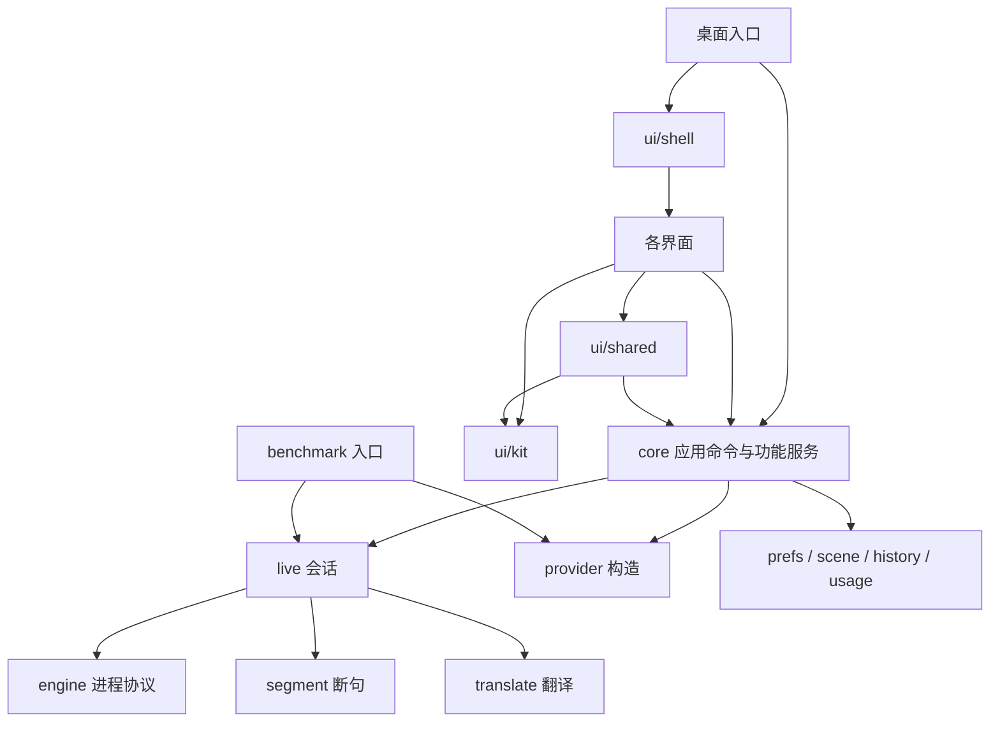

# 架构

[English](architecture.md)

本文描述维护中的代码边界。开发与验证入口见 [开发指南](development_zh.md)，边界决策见 [ADR 001](adr/001-state-events-and-runtime-boundaries_zh.md)。

## 目录与职责

| 目录 | 职责 |
| --- | --- |
| `app/` | Go module `tomoru`；应用状态、实时流水线、存储和桌面界面 |
| `app/main.go` | 桌面组装入口；解析应用资源路径，创建根 context，注入平台能力 |
| `app/internal/core/` | 应用命令、各功能状态所有者及协调入口 |
| `app/internal/live/` | 一次实时会话；识别事件、断句、翻译队列及句子生命周期 |
| `app/internal/asr/` | 识别：会话运行的接口、可选的识别引擎（`Specs`）及其适配器：`asr/batch` 运行整段解码器（`asr/sensevoice`、`asr/llama`、`asr/openai`），`asr/qwencloud` 和 `asr/openai` 的 `Realtime` 流式连接云端，`asr/apple` 告诉引擎里的 Apple 识别何时定稿；见[识别适配层](recognition_zh.md) |
| `app/internal/provider/` | 桌面与 benchmark 共用的翻译器构造 |
| `app/internal/engine/`、`resource/` | 子进程协议与显式资源根查找，不依赖桌面框架 |
| `app/internal/segment/`、`translate/` | 断句规则、翻译接口和各翻译实现 |
| `app/internal/lang/` | 语言，用 BCP 47 代码：有哪些、它们的名字（CLDR，来自 `golang.org/x/text`）、各自怎么书写；每个引擎能识别哪些由引擎自己说 |
| `app/internal/prefs/`、`scene/`、`history/`、`usage/` | 用户数据及各自文件格式；`atomicfile/` 提供原子文件替换 |
| `app/internal/proxy/` | 按偏好设置连接云端：走系统代理（MyGo 的 `netproxy`，支持 PAC）、用户填的代理，或直连；Go 的默认 transport 都问它，所以云端识别和翻译、用户的 API、模型下载都按它走，本机回环地址（本地模型的服务）从不走代理 |
| `app/internal/ui/kit/` | 通用控件、设计 token、主题、快捷键输入；不认识应用状态或领域类型 |
| `app/internal/ui/shared/` | 错误与名称展示、音源菜单、快捷键的应用绑定，以及导航接口 |
| `app/internal/ui/shell/` | 窗口、导航、全局快捷键和主线程调度 |
| `app/internal/ui/{guide,settings,panel,overlay,imagecard}/` | 各界面；互不导入，复用 kit、shared 和 subtitle |
| `app/cmd/tomoru-bench/` | 命令行组装、用例、会话记录、参考字幕和 WAV 处理，按文件分工 |
| `engine/mac/` | Swift 音频采集与 Apple 识别引擎 |
| `engine/windows/` | 独立 Go module（cgo）；Windows 音频采集（默认播放设备用 WASAPI 设备环回，指定应用用进程环回）、人声检测、朗读和框选截图；不识别 |
| `engine/asr/` | 独立 Go module；`tomoru-asr`，用下载的模型解码一段段语音 |
| `protocol/fixtures.json` | 三个协议实现共用的 wire fixtures |
| `bench/` | 用例、评分和评测材料；运行产物不进入源码 |
| `scripts/` | 检查、引擎构建及随包资源准备 |

## 状态与命令

`Core` 是 UI 使用的协调入口，功能服务拥有自身状态与行为。设置由 `PreferencesService` 管理，场景与不可变词表由 `SceneService` 管理，图片由 `ImageService` 管理，历史由 `HistoryService` 管理；会话由 `SessionController` 管理，学习/重译由 `LearningService` 管理，引擎选择与准备由 `EngineService` 管理；它们各自拥有任务生命周期。类型先放在 `core` 内，避免把文件拆分误当作跨包接口设计。

界面通过 `Preferences()`、`SceneList()`、`SceneByID()` 取得独立副本。普通输入绑定到本地草稿，再通过 `ApplyPreferences` 或 `UpdateScene` 提交改变的字段；菜单回调直接调用命令，避免修改早已结束的绘制草稿。语言、音源、场景和引擎切换使用相应应用命令。

命令负责更新词表、会话与历史策略，持久化后通知界面。绘制函数不调用保存。保存成功才推进已保存快照，失败数据保留为待保存状态，后续重试；设置与场景采用同目录临时文件替换，保留现有 JSON 格式。非“文件不存在”的读错误必须报告给调用者。

## 实时数据的两种输出

`live.State.Lines` 是供字幕使用的显示快照，最多保留十句。任何完整记录都不得从它推断句子是否完成。

`Config.OnLine` 接收完整 `LineEvent`，包括 committed、progress、completed；每个已提交 ID 都有一次最终结果，翻译落后和取消也有明确结果；没有翻译器时（`Config.Translator` 为 nil，字幕仅显示原文），提交即是最终结果，没有译文也没有错误，不做草稿、不排队、不预热。回调有序分发并必须快速返回。队列溢出、或几句同时翻译（`Config.Parallel`，云端为三句）时，较新 ID 可能先完成，写入顺序记录的消费者需要按 ID 排序、等待前句完成。`LineMetadata` 在实际提交时同步取得不可变的场景与记录策略，随后由事件携带，避免异步分发期间的场景切换改写归属。关闭历史记录会使此前未写入的记录授权失效。

记录文件只在追加一句、读取、改写或删除的那一刻打开，同一文件的这些操作按路径串行（`history.lock`）：录制中的会话也能学习专名或重译，改写时保留读取之后新增的句子；也能删除，之后的句子另起一个文件。Windows 不能替换或移动打开着的文件。

历史写入成功后才移除待写句子；暂时写入失败时保留数据，后续事件、会话切换和退出时重试。待重试的旧会话保持独立文件边界。benchmark 同样记录句子事件。停止和切换会话必须等待输出收尾，拒绝旧会话迟到的回调。

使用统计按事件发生日期累计。`live.State.StatsAt` 在产生快照时记录，`SpeechEnd` 保留最近声段的音频结束时刻；`sessionReports` 在 UI 调度前对连续累计值求差，保存每个会话独立的每日数字。离散计数使用事件日期，语音时长按音频区间跨本地午夜拆分。监听时长包含静音，独立按本地日历拆分，遇到运行时终态立即截止，不计入等待 UI 处理的时间。停止只合并和保存已经归日的统计，不能把整场数据归到停止当天。已有 JSON 格式保持兼容；旧汇总缺少事件日期，不自动重新分配历史数字。`core/stats_midnight_test.go` 和 `live/stat_timing_test.go` 覆盖跨日、报告延迟及停止后的归属。

## 生命周期与平台边界

桌面入口创建根 context。应用任务、会话、截图选择、图片翻译、学习、重译及系统查询从它派生；替换任务时取消前一个，回调检查任务身份。关闭应用时先取消工作，再有时限地等待子进程和工作者。

把模型移到别的文件夹（`Core.MoveModels`）前，先停下会话和两个 llama-server（它们开着模型文件），管理器也等下载停下：Windows 不能移动或删除开着的文件。移动结束前，不下载、不删除，也不用本地模型启动（`core.ErrModelsMoving`）。所有文件都到了新文件夹才切换过去，失败或退出时放回原处；原来在翻译的，移完接着翻译。

UI 主线程调度使用可取消 FIFO；生产者不等待主线程消费，避免主线程停止会话时与工作者互相等待。overlay 的指针观察使用可停止 ticker。模型服务的健康及身份请求绑定 context，同时设每请求超时；子进程停止需要回收。

平台差异只放在边界：引擎进程（macOS Swift、Windows Go）、`capture`（框选截图都走引擎的 `select`，它报告选区位置：macOS 上它运行系统的 `screencapture`，Windows 上是自己的框选窗口）、`resource.Hide`（Windows 上子进程不弹控制台）、托盘图标（Windows 上按深浅色着色；左键打开面板、右键打开系统快捷菜单，macOS 和 Windows 一致）和少量平台文案（`ui/shared.OnWindows`）。Windows 没有系统识别，起初不选任何识别（`prefs.DefaultASR` 为空，开始翻译时报 `core.ErrNoASR`），由用户在引导或设置里选本地模型（选了才下载）或云端识别；引导跳过授权步骤（`core.AsksAccess`）。

`resource.Bin` 只在入口显式传入的 roots 中查找，不访问 MyGo、当前工作目录或仓库标记。桌面入口决定打包和开发资源根；benchmark 接受 `-resources`。`provider` 接受已确定的配置，不读取 UI 设置或平台 API。

## 约束的验证

`app/layers_test.go` 为每个内部包族列出允许依赖，并解析各平台源码。新包族必须分类；子包继承约束。`kit` 不能依赖业务包，界面不能互相依赖，应用/流水线不能依赖 MyGo 的任意子包。`core/coretest` 仅是桌面测试适配器，不得进入生产依赖。

同一文件还禁止 UI 访问可变设置/场景字段或调用保存；`design_test.go` 维护设计 token 和依赖约束。协议 fixtures 由应用 Go、ASR Go、Swift 验证器读取；检查还会对 Swift 生产代码做类型检查。检查和测试不访问真实音频、不下载模型、不使用云端密钥。
